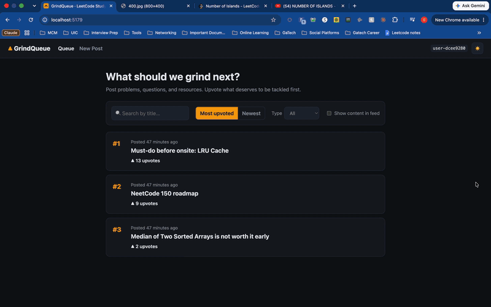

# Web Development Final Project - GrindQueue

Submitted by: **Sravani Bhamidipaty**

This web app: **GrindQueue is a LeetCode / interview-prep forum. Users post problems, questions, resources, and opinions, then upvote them so the most important things to study rise to the top, turning the feed into a shared priority queue.**

Deployed site: **[https://grind-queue.onrender.com](https://grind-queue.onrender.com)**

## Required Features

The following **required** functionality is completed:

- [x] **Web app includes a create form that allows the user to create posts**
  - Form requires users to add a post title
  - Forms should have the _option_ for users to add:
    - additional textual content
    - an image added as an external image URL
- [x] **Web app includes a home feed displaying previously created posts**
  - Web app must include home feed displaying previously created posts
  - By default, each post on the posts feed should show only the post's:
    - creation time
    - title
    - upvotes count
  - Clicking on a post should direct the user to a new page for the selected post
- [x] **Users can view posts in different ways**
  - Users can sort posts by either:
    - creation time
    - upvotes count
  - Users can search for posts by title
- [x] **Users can interact with each post in different ways**
  - The app includes a separate post page for each created post when clicked, where any additional information is shown, including:
    - content
    - image
    - comments
  - Users can leave comments underneath a post on the post page
  - Each post includes an upvote button on the post page.
    - Each click increases the post's upvotes count by one
    - Users can upvote any post any number of times
- [x] **A post that a user previously created can be edited or deleted from its post pages**
  - After a user creates a new post, they can go back and edit the post
  - A previously created post can be deleted from its post page

The following **optional** features are implemented:

- [x] Web app implements pseudo-authentication
  - Users can only edit and delete posts by entering the secret key set during post creation
  - On launch, each user is assigned a random user ID that is shown on their posts and comments; only that user can delete their comments
- [x] Users can repost a previous post by referencing its post ID. On the post page of the new post
  - Users can repost a previous post by referencing its post ID
  - On the post page of the new post, the referenced post is displayed and linked, creating a thread
- [x] Users can customize the interface
  - Light/dark color scheme toggle
  - Option to show each post's content and image on the home feed
- [x] Users can add more characterics to their posts
  - Users can share and view web videos (YouTube links embed)
  - Users can set flags (Problem, Question, Resource, Opinion) while creating a post
  - Users can filter posts by flags on the home feed
- [ ] Users can upload images directly from their local machine as an image file
- [x] Web app displays a loading animation whenever data is being fetched

The following **additional** features are implemented:

- [x] Difficulty tag (Easy / Medium / Hard) and a link to the LeetCode problem on each post
- [x] Feed ranks posts (#1, #2, …) when sorted by upvotes, like a study priority queue

## Video Walkthrough

Here's a walkthrough of implemented user stories:

GIF created with macOS Screen Recording, converted with ffmpeg

## Setup

1. Create a Supabase project, open **SQL Editor**, and run `supabase/schema.sql` (creates `posts` + `comments`, disables RLS, adds sample posts with secret key `grind`).
2. Copy `.env.example` to `.env` and fill in your project URL and anon/publishable key.
3. `npm install` then `npm run dev`.

### Deploying to Render

Push to GitHub, then in Render choose **New → Blueprint** and select the repo (`render.yaml` sets the build, the `dist` folder, and the SPA rewrite). Enter `VITE_SUPABASE_URL` and `VITE_SUPABASE_KEY` when prompted. Vite bakes these in at build time, so after changing them, redeploy.

## Notes

The secret key is pseudo-authentication only. With RLS disabled, anyone with the anon key can read or modify the tables directly, so don't reuse a real password.

## License

    Copyright 2026 Sravani Bhamidipaty

    Licensed under the Apache License, Version 2.0 (the "License");
    you may not use this file except in compliance with the License.
    You may obtain a copy of the License at

        http://www.apache.org/licenses/LICENSE-2.0

    Unless required by applicable law or agreed to in writing, software
    distributed under the License is distributed on an "AS IS" BASIS,
    WITHOUT WARRANTIES OR CONDITIONS OF ANY KIND, either express or implied.
    See the License for the specific language governing permissions and
    limitations under the License.
